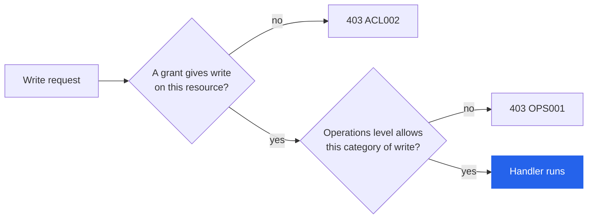

# Authorization

Cetacean decides which resources an identity may view and change with grant-based access control. It combines with
any [authentication][authentication] provider.

Three rules decide how much access an identity has:

- [`auth.mode`][auth.mode] is `none`: authorization is bypassed. A policy configured in this mode has no effect.
- No policy configured: every authenticated identity has full access.
- A policy configured: access is default-deny. An identity sees only what a grant covers.

## Grants

A grant is a tuple of resources, audience, and permissions. Every grant whose audience matches the identity applies,
and their permissions are unioned. There are no deny rules, so adding a grant can only widen access.

```yaml
grants:
  - resources: ["stack:webapp-*", "stack:api-*"]
    audience: ["group:engineering"]
    permissions: ["read", "write"]

  - resources: ["*"]
    audience: ["group:ops"]
    permissions: ["read", "write"]

  - resources: ["stack:public-*"]
    audience: ["user:*@example.com"]
    permissions: ["read"]
```

### Resources

A resource expression is `type:pattern`. Valid types are `service`, `stack`, `node`, `task`, `config`, `secret`,
`network`, `volume`, `plugin` and `swarm`. A bare `*` matches every resource of every type; every other expression
must name a type. Patterns are globs (`*`, `?`, `[...]`, and `\` to escape any of them) matched against the
identifier the resource is keyed by:

| Type                                                                  | Pattern matches                         |
| --------------------------------------------------------------------- | --------------------------------------- |
| `service`, `stack`, `config`, `secret`, `network`, `volume`, `plugin` | Resource name                           |
| `node`                                                                | Hostname, or the node ID if it has none |
| `task`                                                                | Task ID                                 |
| `swarm`                                                               | The single resource `swarm:cluster`     |

Two inheritance rules widen a grant beyond a literal match:

- A `stack:X` grant covers the stack and every service, task, config, secret, network, and volume in it.
- A `service:X` grant covers that service's tasks. A task also inherits the stack of its parent service.

Because membership follows the `com.docker.stack.namespace` label, setting that label to a stack, through a label edit
or a create, needs `write` on that stack as well as on the resource. Rolling a service back restores its whole
previous specification, labels included, so it isn't guarded the same way: a caller can't set that up through
Cetacean alone, since every label write already needs write on the destination.

Task patterns match task IDs, which change every time a replica is replaced. Grant the parent service or the stack
instead of naming tasks.

### Audience

`user:pattern` matches the identity's subject or email. `group:pattern` matches any of its groups. Patterns are globs
again, a bare `*` matches everyone, and a grant with no `audience` field also matches everyone.

### Matching users by email

In `oidc` mode, an email the identity provider marks unverified is ignored for matching. An absent `email_verified`
claim isn't treated as unverified, since some providers never send it.

Even a verified address isn't a stable identifier: a provider can reassign it to someone else, and some let users
change their own. Whoever holds a recycled `alice@example.com` inherits every `user:alice@example.com` grant. To rule
that out, set [`acl.oidc_user_claims`][acl.oidc_user_claims] to `["sub"]` and name users by subject, or grant through
`group:` audiences instead. The default, `["sub", "email"]`, matches both.

The setting is read at startup, not reloaded with the policy file, so changing it takes a restart. It's applied when a
grant is checked, so sessions and OAuth tokens issued before the restart follow it too. It covers OIDC identities and
the OAuth tokens issued to them only. The other modes keep matching `user:` on subject and email, since each establishes them on its
own terms: Tailscale from the login name, `cert` from the certificate, and `headers` from the trusted proxy.

### Permissions

`read` and `write`. `write` implies `read`, so a write grant needs no separate read grant.

`read` governs list and detail endpoints, search, history, Atom and JSON feeds, topology,
[recommendations][recommendations] and SSE streams. `write` governs every mutation. Lists never fail on a missing
grant: unreadable items are filtered out of the response, and `total` counts only what the identity may see.
A history entry shows who made the change to anyone who may read it. It names their subject, display name,
provider, and OAuth client, but not their email or groups.

Creating a config or secret needs `write` on the name being created, so `secret:team-*` lets a team create secrets
inside its own prefix and nowhere else. Installing a plugin needs `write` on `plugin:*`. Attaching a secret, config,
or network to a service, or mounting a named volume, needs `read` on it as well as `write` on the service, unless
the service already has it attached.

## Policy configuration

Provide the policy inline through [`acl.policy`][acl.policy], which requires a restart to change,
or as a file through [`acl.policy_file`][acl.policy_file], which is hot-reloaded when the file
changes. Neither setting has a command-line flag; set them through the environment or the config file. Inline takes
precedence when both are set.

An inline policy is parsed as JSON, TOML or YAML by auto-detection. A policy file is parsed by its extension
(`.json`, `.toml`, `.yaml`, `.yml`), falling back to auto-detection for any other extension.

A malformed or invalid policy at startup stops the server. A policy file is watched and swapped atomically on change;
an invalid update is logged and rejected, leaving the previous policy in force. Cetacean logs a warning if the policy
file is world-readable.

An empty grant list (`grants: []`) is valid and denies everything.

## Provider grant sources

An auth provider can carry per-user grants on the identity itself. These complement the policy rather than replacing
it: the identity's own grants are added to whatever the policy already grants it. Only the active auth mode's source
is read.

| Provider    | Source                        | Setting                                                |
| ----------- | ----------------------------- | ------------------------------------------------------ |
| `tailscale` | Peer capability in the CapMap | [`acl.tailscale_capability`][acl.tailscale_capability] |
| `oidc`      | Custom token claim            | [`acl.oidc_claim`][acl.oidc_claim]                     |
| `headers`   | Proxy-injected header (JSON)  | [`acl.headers_acl`][acl.headers_acl]                   |
| `cert`      | Policy only                   | —                                                      |
| `none`      | Not applicable                | —                                                      |

Each source expects a JSON array of grant objects carrying `resources` and `permissions`. `audience` is ignored,
since a provider grant always applies to the identity carrying it. An invalid grant is dropped without an error, so
check there first when a grant seems to have no effect.

With [`acl.headers_capability`][acl.headers_capability] set, the header holds an object instead, and the array under
that key is read. This is the shape `tailscale serve` sends in `Tailscale-App-Capabilities`, so grants can live in the
tailnet policy:

```json
"app": {
  "example.com/cap/cetacean": [{ "resources": ["*"], "permissions": ["read", "write"] }]
}
```

Serve merges every matching tailnet grant into that one array, and each entry is added like any other provider
grant. Pair it with `acl.policy = "grants: []"`: without a policy every authenticated identity has full access, and
the capability grants change nothing. A missing key or a value of the wrong shape grants nothing. See [behind
Tailscale serve][tailscale-serve] for the full configuration.

> [!NOTE]
> OIDC browser sessions don't carry raw token claims, so `acl.oidc_claim` grants apply to bearer-token requests
> only. Grant browser users through the policy, matching on `group:` audiences.

A token the [authorization server][oauth-tokens] issues carries the provider grants its user held when they approved
the client, since none of the headers or claims a source reads arrive with it. Refreshing keeps them; a grant
removed at the provider stops applying when the client authorizes again or its grant expires.

## Interaction with operations level

[Operations level][operations-level] and grants are independent checks, and a write needs both to
pass. Operations level is a global ceiling on which categories of write the server exposes at all; grants decide
which resources a given identity may write. A common pairing is `server.operations_level = 1` with per-team grants.



| Grant          | Operations level | Result                |
| -------------- | ---------------- | --------------------- |
| Grants `write` | Allows           | Allowed               |
| No `write`     | Allows or blocks | Denied (`403 ACL002`) |
| Grants `write` | Blocks           | Denied (`403 OPS001`) |

Denied requests answer with an [RFC 9457](https://www.rfc-editor.org/rfc/rfc9457) problem document:

| Code                          | Status | Meaning                                                                                                       |
| ----------------------------- | ------ | ------------------------------------------------------------------------------------------------------------- |
| [`ACL001`](api/errors#ACL001) | 403    | Read denied on a detail endpoint, the identity holds no grants at all, or a metrics query lacks `read` on `*` |
| [`ACL002`](api/errors#ACL002) | 403    | Write denied on this resource                                                                                 |
| [`OPS001`](api/errors#OPS001) | 403    | The operation needs a higher operations level than the server runs at                                         |

Read responses carry an `Allow` header naming the write methods available on that resource itself, and a `Link`
with `rel="edit"` for each of its sub-resources you may write. Together they are how the dashboard knows which
action buttons to show you; [Response headers][api.response-headers] describes both.

The [Prometheus][monitoring] query endpoints (`GET /metrics`, its event stream, `GET /metrics/labels`, and
`GET /metrics/labels/{name}`) take PromQL, which reaches every service and node. They need a `read` grant on
the bare resource `*`; anything narrower, even `service:*` and `node:*` together, gets `403 ACL001`, and the
dashboard leaves out its charts. MCP [`get_metrics`][mcp.tools.get_metrics] isn't affected: it never runs
the caller's PromQL, so it charts only the services and nodes the caller may read.

## Examples

Everyone browses, only ops writes:

```yaml
grants:
  - resources: ["*"]
    audience: ["*"]
    permissions: ["read"]
  - resources: ["*"]
    audience: ["group:ops"]
    permissions: ["write"]
```

Team-scoped stacks, with shared infrastructure readable by all:

```yaml
grants:
  - resources: ["stack:frontend-*"]
    audience: ["group:frontend"]
    permissions: ["read", "write"]
  - resources: ["stack:api-*"]
    audience: ["group:backend"]
    permissions: ["read", "write"]
  - resources: ["stack:monitoring", "stack:ingress"]
    audience: ["*"]
    permissions: ["read"]
```

On-call with a limited blast radius: writes services and tasks, reads everything else. Pair it with
`server.operations_level = 1`.

```yaml
grants:
  - resources: ["service:*", "task:*"]
    audience: ["group:oncall"]
    permissions: ["read", "write"]
  - resources:
      ["node:*", "swarm:*", "config:*", "secret:*", "network:*", "volume:*"]
    audience: ["group:oncall"]
    permissions: ["read"]
```

Multi-tenant isolation, with no cross-tenant visibility:

```yaml
grants:
  - resources: ["stack:acme-*"]
    audience: ["group:tenant-acme"]
    permissions: ["read", "write"]
  - resources: ["stack:globex-*"]
    audience: ["group:tenant-globex"]
    permissions: ["read", "write"]
```

## Verifying a policy

`GET /profile` returns the current identity together with the grant patterns in effect for it:

```bash
curl -s -H "Accept: application/json" http://localhost:9000/profile | jq .permissions
```

That shows the grant patterns, not the resources they resolve to. To check one resource, read its detail endpoint
and look at the `Allow` header and the `rel="edit"` links, which resolve grants and operations level together.

The [MCP server][mcp] applies the same grants. Its tools and resources are filtered per caller, and a tool the
caller can never use is left out of `tools/list`.

[acl.headers_acl]: configuration#acl.headers_acl
[acl.headers_capability]: configuration#acl.headers_capability
[acl.oidc_claim]: configuration#acl.oidc_claim
[acl.oidc_user_claims]: configuration#acl.oidc_user_claims
[acl.policy]: configuration#acl.policy
[acl.policy_file]: configuration#acl.policy_file
[acl.tailscale_capability]: configuration#acl.tailscale_capability
[api.response-headers]: api#response-headers
[auth.mode]: configuration#auth.mode
[authentication]: authentication
[mcp]: mcp
[mcp.tools.get_metrics]: mcp-tools#get_metrics
[monitoring]: monitoring
[oauth-tokens]: authentication#api-access-tokens
[operations-level]: configuration#operations-level
[recommendations]: recommendations
[tailscale-serve]: authentication#behind-tailscale-serve
