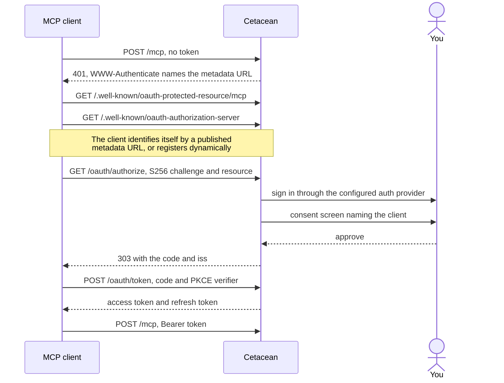

# MCP server

Cetacean can expose your cluster to AI agents over the [Model Context Protocol](https://modelcontextprotocol.io/).
An agent reads the same live state the [dashboard][dashboard] shows and makes the same changes, under the same sign-in
and the same permissions as the people using the dashboard. For what an agent can actually see and do,
see [MCP tools and resources][mcp-tools].

## Turn it on

The server is off by default. Enable it with [`mcp.enabled`][mcp.enabled] on the Cetacean service in your
`compose.yaml`, then redeploy the stack:

```yaml
environment:
  CETACEAN_MCP: "true"
  CETACEAN_OAUTH_ENABLED: "true"
  CETACEAN_AUTH_MODE: oidc
  CETACEAN_PUBLIC_URL: https://cetacean.example.com
```

Both [`mcp.enabled`][mcp.enabled] and [`oauth.enabled`][oauth.enabled] are needed here. Clients authenticate with a
bearer token, and the authorization server that issues it is opt-in on its own—it mints credentials for your
cluster, so nothing turns it on implicitly. `/mcp` authenticates itself rather than going through the usual
middleware, so under any auth mode but `none` it needs either the authorization server or the active mode
listed in [`mcp.auth_bypass`][mcp.auth_bypass]. Cetacean refuses to start with neither, because the endpoint
would serve unauthenticated.

> [!WARNING]
> [`server.public_url`][server.public_url] is the URL clients reach from outside the cluster, not a service name
> on the overlay network. Getting it wrong breaks sign-in, and leaving it unset behind a proxy stops startup
> whenever the authorization server is enabled.

Also set [`oauth.signing_key`][oauth.signing_key]. Without it Cetacean generates a new key on every restart, and every agent
has to sign in again after a redeployment. Generate one with `openssl rand -hex 32`.

## Connect a client

The endpoint is served at `{base_path}/mcp`. Point an MCP-capable client at it:

```jsonc
// Claude Code: .mcp.json
{
  "mcpServers": {
    "cetacean": {
      "type": "http",
      "url": "https://cetacean.example.com/mcp"
    }
  }
}
```

On first connect the client asks you to sign in through whichever auth provider you configured, then shows a
consent screen naming the client. Approve it and the agent is connected. There's no client secret to
generate and nothing to register by hand.

You are asked to approve a client once, not every session. Approval lasts [`oauth.consent_ttl`][oauth.consent_ttl] (90 days
by default) and renews each time you approve. Set it to `0s` to be asked every time. You are always asked again if the
client changes its name or redirect URLs.

### Protocol revisions

Cetacean speaks MCP `2026-07-28` in full and `2025-11-25`, the revision most clients and client libraries use today, without
sessions. A `2025-11-25` client connects through the usual `initialize` handshake and can call every tool, read every
resource, and use every prompt. What it can't do is wait for the server to tell it something: it gets no stream to
receive notifications on, so resource subscriptions and list-change notices are left out of what the server offers it.
Every older revision is refused.

## Decide what an agent may change

An agent is never more privileged than the identity that signed in. Two controls narrow it further.

[`mcp.operations_level`][mcp.operations_level] caps what agents may do, independently of the dashboard:

| Level | An agent may                                                                                                                                                            |
|-------|-------------------------------------------------------------------------------------------------------------------------------------------------------------------------|
| `0`   | Read only                                                                                                                                                               |
| `1`   | Scale, restart, update images, roll back                                                                                                                                |
| `2`   | Also edit service and node configuration, create configs and secrets, and attach volumes                                                                                |
| `3`   | Also add bind mounts, change node availability or role, and remove anything; and change the image, command, or placement of a service with host access, or roll it back |

> [!CAUTION]
> At level `3` an agent can bind-mount any host path, and binding `/var/run/docker.sock` gives the container control
> of the whole cluster. Demoting managers can also cost the swarm its Raft quorum.

A service has host access when its current or previous spec carries a bind, named-pipe, or cluster mount, a volume
with driver options, or an added capability. Below level `3`, an agent may scale and restart such a service but not
change what runs in it, since the new image or command would inherit the access.

It inherits [`server.operations_level`][server.operations_level] when unset. Setting it lower is how you let your team
scale services from the dashboard while agents stay read-only.

[Authorization][authorization] grants then apply per resource, exactly as they do for the dashboard. An agent holding
read-only grants is offered only the read tools; resources it may not read are reported as not found rather than as
forbidden, so the tool list never reveals what exists.

### Confirm impactful changes

A model that says it asked you isn't evidence that it did. So before a level-3 tool removes anything or changes a
node's availability or role, Cetacean asks you itself, through the client: the question names the resource, what the
change does to it—the tasks a removal stops, the services that use a secret, what a drain moves, how a promotion or
demotion leaves the managers' quorum—and what can't be undone. It names only what you may read, and counts the rest.
Nothing is written unless you confirm, and declining is reported to the agent as an answer, not a failure.

The question needs a client that supports elicitation. One that doesn't is served as before, unless
[`mcp.require_confirmation`][mcp.require_confirmation] is on, which refuses it the level-3 tools. A `2025-11-25`
client can't be asked either, since Cetacean serves that revision without sessions.

Swarm doesn't keep hostnames unique. When a tool is given a hostname that several nodes share, a client that supports
elicitation asks you which one you mean, showing each node's ID, address, role, availability, engine version and
labels. A client without it gets an error listing the IDs, and reading a node resource by such a hostname always does.

A confirmation is a guard against an agent acting on its own, not an authorization: the operations level and your
grants are checked before you are asked and again once you have answered.

### Keep secret values out of the conversation

An agent creating a secret would otherwise pass its value as an argument, which puts it in the conversation, the
host's logs, and the model provider's request. A client that supports URL elicitation sends you to Cetacean's
dashboard instead: a page opens with the name and labels the agent chose, you enter the value there, and it goes
from your browser to Cetacean under your own session. The agent only learns that the secret exists. The page
refuses anyone but the person whose agent asked, so this needs a token from the
[authorization server][oauth.enabled]; a client authenticated any other way is treated as not supporting it.

Such a client may not pass a value itself. Other clients still can, unless
[`mcp.inline_secret_values`][mcp.inline_secret_values] is off.

## Wait for changes to take effect

Docker accepts a change the moment you ask for it, which tells you nothing about whether it worked—the image may still
be pulling, or a placement constraint may be unsatisfiable. Scaling, restarting, image updates, and rollbacks can
therefore wait for the cluster to settle before reporting back, so an agent says "done" when the replicas are actually
running.

Clients that support this opt in per call; the agent handles it, there's nothing to configure. A change that hasn't
settled within five minutes is reported as failed, and [`mcp.max_concurrent_tasks`][mcp.max_concurrent_tasks] (default
is 32) caps how many such waits run at once.

Four tools wait; the [API][api] offers the same wait on five service endpoints, adding endpoint mode. That's
deliberate rather than an oversight: waiting over MCP costs a held task slot per call, so it's offered on the changes
an agent routinely makes and watches, while an HTTP client waits on its own connection and pays for nothing it isn't
using.

## Trace agent activity

Point [`tracing.endpoint`][tracing.endpoint] at an OpenTelemetry collector that accepts OTLP over HTTP:

```yaml
environment:
  CETACEAN_OTEL_ENDPOINT: http://collector:4318
```

You get a span per agent request and a nested span per tool call, tagged with the tool name and an error status when it
fails—so you can see which agent scaled what, and when. If the calling agent is already tracing, its trace context is
picked up and Cetacean's spans join the same trace, putting the agent's turn and the Docker call it produced on
one timeline.

Tracing stays off until the endpoint is set. A malformed endpoint stops startup rather than silently exporting nowhere.

## Before you expose it

- **Run it behind TLS.** Cetacean warns at startup if MCP is enabled without TLS outside auth mode `none`, unless
  [`server.public_url`][server.public_url] is an `https` URL, which means a proxy terminates TLS.
- **Auth mode `none` leaves `/mcp` open.** Anyone who can reach it gets whatever the operations level allows.
  Use it only on a trusted network.
- **Set [`server.cors.origins`][server.cors.origins] if the consent screen crosses origins.** It also guards
  `/mcp` itself against DNS rebinding, together with the origin of [`server.public_url`][server.public_url],
  which `/mcp` always admits. Name the origins rather than using `*`: a browser-based client's every
  call is a `POST`, and a wildcard isn't trusted for cross-origin writes, so those calls are refused.
  Non-browser clients send no `Origin` and are unaffected by either check.
- **Run a single replica.** Sign-in state lives in one process; see [How it works](#how-it-works).

## Troubleshooting

| Symptom                                                      | Cause                                                                                                                                                                  |
|--------------------------------------------------------------|------------------------------------------------------------------------------------------------------------------------------------------------------------------------|
| Client reports `unsupported protocol version`                | The client is older than MCP revision `2025-11-25`. Upgrade it; see [Protocol revisions](#protocol-revisions).                                                         |
| Every agent must sign in again after a redeploy              | [`oauth.signing_key`][oauth.signing_key] is unset, so a new key was generated at startup.                                                                              |
| Sign-in fails or redirects somewhere unreachable             | [`server.public_url`][server.public_url] isn't the URL clients reach from outside.                                                                                     |
| Every request to `/mcp` is refused with `403 forbidden host` | A proxy on the same host keeps the public `Host`, and [`server.public_url`][server.public_url] doesn't name it. See [Behind a reverse proxy](#behind-a-reverse-proxy). |
| A revoked agent still works for a while                      | Access tokens stay valid until they expire. Lower [`oauth.access_token_ttl`][oauth.access_token_ttl].                                                                  |
| A subscription is refused with `429`                         | 64 subscription streams are already open. The client retries after `Retry-After`.                                                                                      |
| A subscription is refused with `Invalid params`              | It names more than 256 resource URIs, the most one stream watches. See [MCP tools and resources][mcp-tools].                                                           |
| `get_logs` fails with "too many log reads"                   | 32 log reads are in flight across MCP and the REST API, or 8 from this caller. Retry shortly.                                                                          |
| A call is refused with `413`                                 | Its request body is over 1 MiB.                                                                                                                                        |
| An agent reports a change it made as gone                    | Its result was discarded after [`mcp.task_ttl`][mcp.task_ttl]. The change itself still happened.                                                                       |
| `cert` auth mode: client can't connect                       | mTLS can't drive a browser consent screen. Set [`mcp.auth_bypass`][mcp.auth_bypass] to `cert`; the authorization server can then stay off.                             |

## Behind a reverse proxy

Clients discover how to sign in by fetching well-known documents from Cetacean, so the proxy has to pass these
through to `/mcp`'s host alongside the endpoint itself:

```
/.well-known/oauth-protected-resource
/.well-known/oauth-protected-resource/mcp
/.well-known/oauth-authorization-server
/.well-known/openid-configuration
/oauth/authorize   /oauth/token   /oauth/revoke   /oauth/register   /oauth/jwks
```

Under a [`server.base_path`][server.base_path], forward `/.well-known/*` from the host root as well
as from under the prefix. RFC 9728 §3.1 has a client build the metadata URL by inserting
`/.well-known/oauth-protected-resource` **after the host**, so it asks for
`https://host/.well-known/oauth-protected-resource/prefix/mcp`—a path that never reaches Cetacean
if the proxy only forwards `https://host/prefix/*`. Both spellings are served; only the first is the
one a conformant client derives on its own.

A proxy on the same host as Cetacean (`tailscale serve`, for one) connects over loopback and usually keeps the
public `Host`. `/mcp` refuses a loopback request whose `Host` isn't a loopback name, to guard against DNS
rebinding, and admits only the host of [`server.public_url`][server.public_url] as the exception. Set it to the
URL the proxy serves, or have the proxy rewrite `Host` to `localhost`.

## How it works

Cetacean is its own OAuth 2.1 authorization server for `/mcp` and the web API, implementing the MCP `2026-07-28`
authorization profile.
A client discovers it, sends you through your configured auth provider, and exchanges the result for an access token and
a refresh token. Access tokens are scoped to this deployment, so one can't be replayed against another Cetacean.

`/mcp` is one of two protected resources—the [web API][api-tokens] is the other—and each has its own metadata
document and its own audience. `/mcp`'s document is at `/.well-known/oauth-protected-resource/mcp`; the one at the
root describes the API. A token for either is refused by the other, even though one path lies under the other:
approving an agent for MCP isn't approving it to delete your services. Clients that read the metadata URL out of the
`WWW-Authenticate` header on the 401, as the profile requires, need no changes.

Access tokens follow the JWT profile in [RFC 9068](https://www.rfc-editor.org/rfc/rfc9068): the header carries
`typ: at+jwt`, and the token is refused unless it does, so an ID token can't be presented where an access token
belongs. Refresh tokens are opaque and unaffected.



The consent screen labels how the client identified itself. **Verified** means the client is named by a URL Cetacean
fetched and checked. **Self-registered** means the client named itself; those are never remembered, so you approve them
every time. The screen lists every redirect URI the client registers, since a remembered approval covers all of them.
It shows no client logo, because the page loads nothing from elsewhere.

Refresh tokens, approvals, and dynamically registered clients are stored in `oauth-tokens.json` under
[`storage.data_dir`][storage.data_dir], at mode `0600`—anyone who can write that file can pre-approve a client. Nothing
else survives a restart, which is why a single replica is required: the file is node-local, and an unset signing key
would leave each replica signing differently.

Registrations outlive a restart, and `/oauth/register` is open to anyone who can reach it. A flood from rotating
addresses evicts legitimate clients up to [`oauth.dcr_max_clients`][oauth.dcr_max_clients] and is restored on every
start, so raising the cap afterwards doesn't recover them: delete `oauth-tokens.json` and let clients register once
more, or set [`oauth.dcr_enabled`][oauth.dcr_enabled] to `false` if nothing needs dynamic registration. Registrations
carry no expiry—RFC 7591 gives them none.

[api]: api
[api-tokens]: authentication#api-access-tokens
[authorization]: authorization
[dashboard]: dashboard
[mcp-tools]: mcp-tools
[mcp.auth_bypass]: configuration#mcp.auth_bypass
[mcp.enabled]: configuration#mcp.enabled
[mcp.max_concurrent_tasks]: configuration#mcp.max_concurrent_tasks
[mcp.inline_secret_values]: configuration#mcp.inline_secret_values
[mcp.operations_level]: configuration#mcp.operations_level
[mcp.require_confirmation]: configuration#mcp.require_confirmation
[mcp.task_ttl]: configuration#mcp.task_ttl
[oauth.access_token_ttl]: configuration#oauth.access_token_ttl
[oauth.consent_ttl]: configuration#oauth.consent_ttl
[oauth.dcr_enabled]: configuration#oauth.dcr_enabled
[oauth.dcr_max_clients]: configuration#oauth.dcr_max_clients
[oauth.enabled]: configuration#oauth.enabled
[oauth.signing_key]: configuration#oauth.signing_key
[server.base_path]: configuration#server.base_path
[server.cors.origins]: configuration#server.cors.origins
[server.operations_level]: configuration#server.operations_level
[server.public_url]: configuration#server.public_url
[storage.data_dir]: configuration#storage.data_dir
[tracing.endpoint]: configuration#tracing.endpoint
